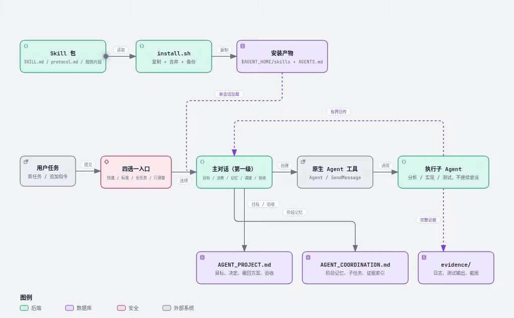

# single-conversation-subagent skill 1.0.2

记录日期：2026-10-19

把“单对话 subagent：两级协作协议”打包成用户级 skill。安装后，新的会话在处理非平凡任务时默认加载并遵守：

- **主对话（第一级 / 协调层）**：发现问题、分析需求、制定顶层目标、授权范围和最终验收；同时直接维护阶段记忆、拆分子任务、创建和调度执行子 Agent、汇总结果。第一级协调不再交给另一个子 Agent。
- **执行子 Agent（第二级）**：名称由主对话按任务起（如“支付模块分析子 Agent”），模型和类型由当前会话环境决定；负责分析、实现或测试，返回证据，不再创建下一级 Agent。

不使用外部桥接式分发。

## 架构视图

完整流程、四选一、验证范围、记忆布局和回传格式见 [docs/单对话subagent-两级协作协议.md](docs/单对话subagent-两级协作协议.md)。

<a href="docs/archify/skill-architecture.html">
  <picture>
    <source media="(prefers-color-scheme: dark)" srcset="docs/archify/skill-architecture-dark.gif">
    
  </picture>
</a>

架构图展示 Skill 包、`install.sh` 安装产物、主对话、原生 Agent 工具、执行子 Agent，以及项目/协作/证据三类记忆。GIF 为 4 秒循环，按系统深浅色自动切换；完整交互版（缩放、路径、动效开关）见 [docs/archify/skill-architecture.html](docs/archify/skill-architecture.html)（下载后用浏览器打开）。

每个新的用户任务开始时先四选一：**快速处理 / 标准执行 / 长任务 / 只调查**，包括“推送吧”“改一下”“跑一下”这类直接命令；同一任务的追问不重复问，只有明确说“不用问，直接做”时才可跳过。纯问答、搜索、单文件小改、简单 Excel、快速查询一般选快速处理；选快速处理或只调查后，不再做验证范围多选。

四选一必须带推荐项并默认勾选；纯问答/小改推荐快速处理，普通工程推荐标准执行，长验证推荐长任务，只读排查推荐只调查；拿不准默认标准执行。

未选择或超时默认按“标准执行”继续，不按推荐项，不重复追问；真正的 15 秒倒计时由客户端实现。

默认记忆布局跟随项目根目录：

```markdown
## 记忆文件
- 项目记录：<项目根>/docs/agent/AGENT_PROJECT.md
- 协作记录：<项目根>/docs/agent/AGENT_COORDINATION.md
- 证据目录：<项目根>/docs/agent/evidence/
```

标准执行和长任务在同一对话内每个新任务开始前先做一次验证范围多选：操作、时机（本轮/收尾）、目的、预计耗时、资源、风险、说明。只给一个推荐路径：**快速冒烟（本轮）+ 定向回归（收尾）**；其他选项不单独标推荐/默认。定向/全量回归和稳定性放在收尾执行，不每轮重复；未选中的操作不进入计划；烧录/擦除等破坏性操作单独确认。

“不做测试”和“不做测试，记录测试方法”二选一，且与测试操作互斥；前者标记 `NOT_RUN`，后者只记录方法，不标 `PASS`。

四选一和验证范围每次只能有一个推荐路径，不得出现多个“推荐/默认”。验证范围未选择/超时，按唯一推荐路径（快速冒烟 + 收尾定向回归）继续，不重复追问；真正倒计时由客户端实现。

## 设计初衷与上下文预算

长任务模式的核心是隔离长执行线：主对话只保留目标、决策、未决问题、下一步和证据路径；执行细节下沉到子 Agent 和 `docs/agent/evidence/`。它不是缓存清理机制，主对话仍会随轮次增长。

- 三级记忆：主对话 → `AGENT_COORDINATION.md` → 证据文件。
- 子 Agent 最终回传固定字段，不贴原始日志（建议 ≤ 1–2 KB）。
- 每个工作包/阶段结束写 handoff；主对话接近上下文上限时新开会话恢复。
- 长测试后台执行，返回 PID/日志/停止方式；不长期占用子 Agent。
- 子 Agent 上下文过大时停止并新建，传入摘要和证据路径。

## 版本变化

### 1.0.2

- 第一级协调由主对话直接承担：阶段记忆、拆分、创建和调度子 Agent、汇总都在主对话中进行，不再创建“协调子 Agent”。
- 执行子 Agent 只负责分析/实现/测试，按任务命名，例如“支付模块分析子 Agent”“回归测试子 Agent”。
- `AGENT_COORDINATION.md` 改由主对话维护；上下文压缩或重启后由主对话从该文件恢复。
- 默认记忆文件改为 `<项目根>/docs/agent/AGENT_PROJECT.md`、`docs/agent/AGENT_COORDINATION.md`；证据目录改为 `docs/agent/evidence/`。
- 任务类型选择恢复为每个新的用户任务一次；同一任务的追问不重复问，直接命令不能跳过。快速处理/只调查不启执行子 Agent，也不做验证范围多选。
- 四选一增加推荐项/默认勾选：普通工程默认标准执行，拿不准也默认标准执行，用户直接确认即可。
- 四选一未选择/超时默认标准执行，不按推荐项，不重复追问；真正倒计时由客户端实现。
- 验证范围未选择/超时按唯一推荐路径（快速冒烟 + 收尾定向回归）继续，不重复追问。
- 标准执行和长任务在同一对话内每个新任务开始前增加验证范围多选；只给一个推荐路径（快速冒烟 + 收尾定向回归），其他选项不标推荐；定向/全量回归和稳定性收尾执行，不每轮重复；增加“不做测试”和“不做测试，记录测试方法”两个互斥选项。
- 增加设计初衷与上下文预算/补救措施：有界回传、阶段 handoff、阈值新会话、长测试后台化、子 Agent 膨胀处理。
- 分发包和默认规则同步更新。

### 1.0.1

- 角色名统一为“协助 Agent”，由主对话按任务命名，不再固定使用模型名或其他固定称呼。
- 移除所有厂商和实现名词，统一使用“主对话、协助 Agent、执行子 Agent、会话环境、原生 Agent 工具、桥接模式”。
- 记忆文件改为 `AGENT_PROJECT.md` / `AGENT_COORDINATION.md`；证据目录改为 `.agent/evidence/`（1.0.2 起默认改为 `docs/agent/evidence/`）。
- 安装器改用 `AGENT_HOME`（默认 `~/.agents`），并支持 `--instructions-file` 指定用户级指令文件。

### 1.0.0

- 首次打包：skill、完整协议、安装/卸载脚本、默认规则片段。

## 包内容

```text
single-conversation-subagent-skill/
├── README.md
├── VERSION
├── install.sh                  # 用户级安装/卸载脚本
├── AGENTS.snippet.md           # 默认规则片段（带幂等标记）
├── single-conversation-subagent/
│   ├── SKILL.md                # skill 本体：触发描述、流程、边界、子 Agent 模板
│   └── references/
│       └── protocol.md         # 完整两级协作协议
└── docs/
    └── 单对话subagent-两级协作协议.md   # 设计记录
```

## 要求

- 会话环境支持原生 `Agent` 工具和 `SendMessage`。
- Linux/macOS 使用 bash 安装脚本；Windows 可按“手动安装”复制文件。
- 脚本只写用户目录，不需要 `sudo`。

## 安装

### 从 GitHub 仓库安装

```bash
git clone https://github.com/jinsc123654/single-conversation-subagent-skill.git
cd single-conversation-subagent-skill
bash install.sh --with-default-rule
```

### 从发布包安装

解压后进入包目录：

```bash
tar -xzf single-conversation-subagent-skill-1.0.2.tar.gz
cd single-conversation-subagent-skill-1.0.2
```

### 推荐：安装 skill 并设为默认规则

```bash
bash install.sh --with-default-rule
```

会把 skill 安装到 `$AGENT_HOME/skills/single-conversation-subagent/`，并把带标记的默认规则追加到 `$AGENT_HOME/AGENTS.md`。`AGENT_HOME` 默认是 `~/.agents`。

### 指定用户级指令文件

如果当前会话环境读取的指令文件不在 `$AGENT_HOME/AGENTS.md`，直接指定它：

```bash
bash install.sh --instructions-file /path/to/AGENTS.md
```

### 只安装 skill

```bash
bash install.sh
```

只复制 skill，不修改指令文件。此时 skill 会在相关任务中按描述触发，但不会强制所有对话默认加载。

### 自定义 agent 配置目录

```bash
AGENT_HOME=/path/to/agent-home bash install.sh --with-default-rule
```

`AGENT_HOME` 应指向包含 `skills/` 和 `AGENTS.md` 的用户级目录，默认是 `~/.agents`。

## 安装脚本行为

- 安装前如果目标 skill 目录已存在，会先复制备份到 `*.bak.<时间戳>.<pid>`，再替换。
- `--with-default-rule` 修改 `$AGENT_HOME/AGENTS.md` 前会备份原文件；如果已有 `<!-- single-conversation-subagent begin -->` 标记，则不重复追加。
- `--instructions-file <path>` 把规则写入指定文件，并隐含 `--with-default-rule`。
- `--uninstall` 会备份并删除已安装的 skill 目录，并移除指令文件中带标记的整段规则。若当初用了自定义指令文件，卸载时也要传同一个 `--instructions-file`。
- 拒绝 `AGENT_HOME=/` 和不符合 `<AGENT_HOME>/skills/single-conversation-subagent` 的删除目标，避免误删。
- 不修改工作区文件、不写系统目录、不执行网络操作。

## 验证

1. 重开一个新的会话，让 skill 注册表和用户级指令文件重新加载。
2. 检查文件存在：

   ```bash
   ls "$HOME/.agents/skills/single-conversation-subagent/SKILL.md"
   grep -n 'single-conversation-subagent' "$HOME/.agents/AGENTS.md"
   ```

   若使用了自定义 `AGENT_HOME` 或 `--instructions-file`，把路径换成实际位置。

3. 在会话里给一个跨文件任务，例如“调查这个 bug 的根因并给出修复与测试”，模型应加载 `single-conversation-subagent`，由主对话定义工作包、维护阶段记忆、拆分并创建执行子 Agent。
4. 如果客户端支持斜杠命令，也可显式调用 `/single-conversation-subagent <任务>`。

## 手动安装（Windows / 无 bash）

1. 把 `single-conversation-subagent/` 整个目录复制到：
   `<AGENT_HOME>/skills/single-conversation-subagent/`
2. 把 `AGENTS.snippet.md` 的内容追加到当前会话环境的用户级指令文件。
3. 重开会话。

`AGENT_HOME` 默认对应 `%USERPROFILE%\.agents`，也可使用环境实际读取的目录。

## 卸载

```bash
bash install.sh --uninstall
```

若当初用了自定义指令文件：

```bash
bash install.sh --uninstall --instructions-file /path/to/AGENTS.md
```

或手动删除 `<AGENT_HOME>/skills/single-conversation-subagent/`，并从用户级指令文件删除带 `single-conversation-subagent` 标记的整段内容。

## 行为边界

- 简单问答、单步查询、纯解释性对话不强行起协调层，避免为每个小问题增加两层 Agent 开销；一旦任务进入实现、测试或多步调查，立即切换。
- 工作区自己的指令文件加载在用户级规则之后，可以覆盖或收窄这条默认规则。
- 执行子 Agent 的名称统一用 `<任务>子 Agent`，不要固定使用模型名或其他固定称呼。
- 同一项目仍使用桥接模式时，原生模式应改用 `docs/agent/AGENT_PROJECT_NATIVE.md` / `docs/agent/AGENT_COORDINATION_NATIVE.md`，不要手工修改桥接管理的受管文件。
- 原生模式没有桥接式父子目录独立核验；需要严格进程级审计时，继续使用三层桥接模式。
- skill 和协议不包含密钥、Cookie 或项目私有数据；不要把实际项目的 `docs/agent/AGENT_PROJECT.md` / `docs/agent/AGENT_COORDINATION.md` 打进分发包。
