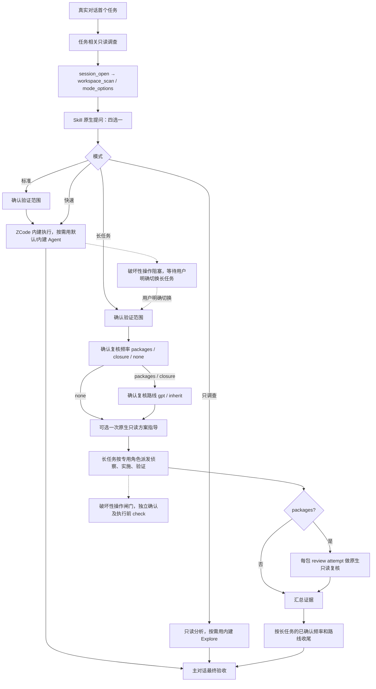

# single-conversation-subagent 3.0.0

单对话两级 Subagent 协作，采用 **Skill 主策略/主问 + 本地 MCP 收集状态/工作流 + 宿主原生 Subagent 执行**。主对话直接协调并最终验收，执行子 Agent 不继续委派；MCP 不创建 Agent，也不默认驱动提问 UI。3.0 为长任务增加 `codex_gate` 包级复核、侦察/实施/验证三角色与扇出预算，并把破坏性操作闸门扩展到所有模式。

本分支面向 **ZCode 4**：主对话直接派发执行子 Agent 和只读复核子 Agent；不使用外部复核 CLI 或额外复核 Skill。MCP 只收集状态和证据，不启动模型。默认 `SCS_QUESTION_CHANNEL=native`，Skill 用宿主原生 AskUserQuestion；`session_open(project_root=<任务项目根>)` 为项目维护独立 `<项目>/.scs` 并记录选择。MCP form/15 秒仅为没有原生提问工具的宿主兜底。推荐项、未回复、取消、RPC 失联和 UI 不出现均不算确认；原生/文本路径没有这个 15 秒期限。



对话模式为快速处理 / 标准执行 / 长任务 / 只调查，推荐项不等于用户确认。标准/长任务首次确认验证范围，快速/只调查跳过。**标准/快速**随后走 ZCode 内建流程，主对话直接处理，仅按需用默认/内建 Agent，不问 SCS 原生复核时机、路由或方案指导。**只调查**保持只读，按需用内建 `Explore`。**只有长任务**自动编排六个专用角色：`codex_gate=packages|closure|none` 对应逐包+收尾、仅收尾、不做包级和收尾复核；适用时确认 `review_route=gpt|inherit`。长任务可在实现前推荐一次原生只读方案指导，用户确认后主对话才派发；指导不替代正式复核。用户明确点名时，可在自动流程外手动调用可用的专用角色，仍守当前模式边界，不启动 SCS 复核问答，也不替代正式复核或闸门。

长任务由主对话直接派发侦察者（`analyze`，只读）、实施者（`implement`，只改 `allowed_files`）、验证者（`test`，只跑获准命令），以及需要时的原生只读复核者。调查阶段有 n 个独立只读子任务时起步 min(4, n) 个侦察者；实现阶段按 `allowed_files` 两两不相交取最大并行集合；默认并发上限 4，没有宿主并发证据时取 1。`packages` 包在 `REVIEW_READY` 前需要 review attempt 的 ACCEPT manifest 且 `review_subject` 当前，文件/定义/结果变化即 `REVIEW_STALE`。破坏性操作在**所有模式**都要先登记 `operation_gate_record`、执行前 `operation_gate_check` 为 `APPROVED`；REJECT 终态，复核不可用时不得伪记 ACCEPT。MCP 不执行、不拦截宿主命令，没有宿主 Hook 时是协议级约束。

“不做测试”和“只记录方法”各自与其他验证操作互斥，均 NOT_RUN；危险操作独立确认。仅用户明确“不用问，直接做”可跳过模式选择，不能因此授权删除、擦除或烧录。超时只认可宿主可观测结果和事先告知的策略；本版服务只记录超时，不自动确认。

## 安装

纯 Skill 不依赖 Python 或 MCP。原生问答或文本继续按模式确认适用选项；标准仍确认验证范围，标准/快速仍走内建流程，只调查仍保持只读。长任务仍按六个专用角色的职责编排，并手工记录工作包和证据。安装命令如下。

```bash
bash install.sh --mode skill --with-default-rule
bash install.sh --check
```

默认目录 `$AGENT_HOME/skills/single-conversation-subagent/`，AGENT_HOME 默认 `~/.agents`。原有无参数、`--with-default-rule`、`--instructions-file PATH`、`--uninstall` 均保留。可指定宿主实际读取的用户指令文件：

```bash
AGENT_HOME=/path/to/agent-home bash install.sh --instructions-file /path/to/AGENTS.md
```

混合安装需要 Python 3.11+，本地 POSIX 文件系统和 bash/tar。此版本安全路径实现已在 Linux 验证；Windows 原生 MCP 运行 **未支持/未移植**，可手动复制 Skill 使用纯文本回退。macOS 待实测。

```bash
bash install.sh --mode hybrid --with-default-rule --project-root /absolute/workspace
bash install.sh --mode hybrid --check
```

如选定 Python 已有 mcp 2.3.0 则使用该解释器；否则在 `$AGENT_HOME/mcp/single-conversation-subagent/venv.<id>` 创建隔离环境并安装依赖。可用 `--python /absolute/venv/bin/python` 或 SCS_PYTHON 指定现有环境。Python 或依赖失败时输出 HYBRID_UNAVAILABLE，Skill 保持可用；`--mode hybrid --check` 会明确报告未就绪。

安装器在修改前备份，只替换本技能的标记块，保留其他技能/项目内容；重复安装不重复注入规则。拒绝目标及其父目录的符号链接、父目录跳转、畸形规则标记和源目录自覆盖。安装器不改写现有客户端 MCP 配置；默认生成 runtime 的 `zcode-example.json`，由用户审查并手动合并。未给 project-root 时须替换示例占位符。**重开对话**以加载 Skill、规则和 Agent。

手动安装：复制 `single-conversation-subagent/` 到宿主实际的 skills 目录，再把 AGENTS.snippet.md 的标记块合入宿主读取的指令文件；无 bash/无 Python 也能使用纯 Skill。不要覆盖其他标记块或已有项目记忆。

## ZCode 4：安装 Skill 与六个专用 Agent

本分支随源码一起分发 [角色设计与派发规则](single-conversation-subagent/references/roles.md)、[协作与等待规则](single-conversation-subagent/references/protocol.md)、[六个角色模板](zcode-agents/) 和安装器。**只复制 `SKILL.md` 不会注册 Agent**。要使用长任务的完整分工，先取回 `zcode-native-agents` 分支，再运行下面的安装命令。

```bash
git clone --branch zcode-native-agents https://github.com/jinsc123654/single-conversation-subagent-skill.git
cd single-conversation-subagent-skill
```

可选安装：不加 `--with-zcode-agents` 不会创建或修改 Agent 配置。默认目标是 `~/.zcode/agents/`（与 `AGENT_HOME` 独立）；如需隔离或使用宿主支持的其他位置，用 `--zcode-agents-dir PATH`，不能放在本 Skill 或 MCP 运行时的受管目录内。安装器只新增缺失的同名文件，不覆盖普通文件、目录或符号链接，不跟随目标目录及其父目录的符号链接。安装要求目标文件系统支持硬链接及 `ln -T`；卸载不移除任何 Agent profiles。

只新增两个继承型 profile：

```bash
bash install.sh --with-zcode-agents
```

完整安装时，先在 ZCode 配好可用的 GPT 和 DeepSeek 模型，替换下方两个 `provider-id/model-id` 占位符，再从仓库根目录执行。`/absolute/workspace` 换成允许 MCP 访问的工作区目录。

```bash
AGENT_HOME="$HOME/.zcode" bash install.sh --mode hybrid --with-default-rule \
  --project-root /absolute/workspace --with-zcode-agents \
  --zcode-gpt-model your-gpt-provider/your-gpt-model \
  --zcode-deepseek-model your-deepseek-provider/your-deepseek-model
```

1. 把 `$HOME/.zcode/mcp/single-conversation-subagent/zcode-example.json` 的服务条目合入 [ZCode MCP 配置](#客户端配置)，保留 `SCS_NATIVE_REVIEW=1`。
2. 新开 ZCode 会话，在 **设置 → Agent 能力 → 子智能体 → 用户** 核对下表六个角色和模型。如果角色已存在，安装器会保留用户自己的设置，请在界面核对它们是否符合分工。
3. 在聊天输入框的 `/` 菜单选择 `single-conversation-subagent`，或按安装后的用户规则开始任务。选「长任务」才自动派发专用角色；「标准执行」和「快速处理」使用 ZCode 自带流程。中文名称只用于识别和派发，任务、对话与回复语言按用户要求；正式审阅正文不限语言，但必须保留协议要求的固定结论行。

| Profile ID（同名 `.md` 文件） | 模型 / 安装条件 | 工具 |
| --- | --- | --- |
| `方案顾问` | `--zcode-gpt-model ID`，只读方案指导 | Read、Grep、Glob |
| `实施工程师` | `inherit`，不设置 `thoughtLevel` | Read、Grep、Glob、Edit、Write |
| `查询侦察员` | `--zcode-deepseek-model ID` | Read、Grep、Glob |
| `测试验证员` | `--zcode-deepseek-model ID` | Read、Grep、Glob、Bash（只执行明确授权的验证命令） |
| `固定审阅员` | `--zcode-gpt-model ID`，用于 `gpt` 路线 | Read、Grep、Glob |
| `继承审阅员` | `inherit`，不设置 `thoughtLevel`，用于 `inherit` 路线 | Read、Grep、Glob |

两个模型选项可独立使用：未给对应的 ID 就跳过该组固定角色，不生成 `inherit` 替代配置。示例 ID 不是内置默认值；请用本机 ZCode 已配置的对应模型 ID，不能填 `inherit`。可分别加 `--zcode-gpt-thought-level LEVEL` 或 `--zcode-deepseek-thought-level LEVEL` 给同组**新装**角色设置 `thoughtLevel`；每个 level 选项都要求同时提供同组模型 ID，值以该模型在本机 ZCode 支持的级别为准，省略时不写入该字段。目录、模型和级别选项均要求 `--with-zcode-agents`；该开关仅支持 `--host zcode`（默认），不可与 `--check` 或 `--uninstall` 合用。

也可在 ZCode UI 中手动创建固定角色，参照 [方案顾问](zcode-agents/方案顾问.md.in)、[查询侦察员](zcode-agents/查询侦察员.md.in)、[测试验证员](zcode-agents/测试验证员.md.in) 和 [固定审阅员](zcode-agents/固定审阅员.md.in) 模板，明确指定模型与工具，不要把含占位符的 `.md.in` 直接放进加载目录。仅 [实施工程师](zcode-agents/实施工程师.md) 和 [继承审阅员](zcode-agents/继承审阅员.md) 可在确认无同名冲突后直接复制。历史英文模板不再由安装器安装；既有英文 profile 不会迁移、改名或删除。

重开会话后核对宿主加载的同名 profile、有效模型和工具；已有自定义 Agent 不会被改成上表配置，目录中有文件也不证明宿主已经加载。固定角色的模型未配置、不可确认或不可用时，报告该角色不可用，不静默改用继承模型。复核改选 `inherit` 路线需要用户明确确认。

`codex-review/` 是历史源文件，不属于此分支支持的运行时，安装器不会安装或调用它。已有独立安装不会被迁移或删除。

## 客户端配置

开发安装与直接入口：

```bash
python3 -m venv .venv
.venv/bin/python -m pip install -e './mcp_server[test]'
.venv/bin/python -m scs_mcp --project-root /absolute/workspace
```

该入口只使用 stdio，不启动 HTTP。stdout 只传 MCP 协议，错误写 stderr；脱敏交互事件保存在任务项目 `<项目>/.scs/state.sqlite3` 的 events 表（每个项目独立；配置根只是工作区边界）。依赖固定 `mcp==2.3.0`，开发环境完整版本见 [requirements-dev.lock](mcp_server/requirements-dev.lock)；项目级约束见 pyproject.toml。重现测试环境可先安装锁文件再安装本包。

ZCode 用户配置位于 `~/.zcode/cli/config.json`。仅将示例服务条目合入现有 `mcp.servers`（不是顶层 `mcpServers`）；保留 `SCS_NATIVE_REVIEW=1`。以下以开发入口为例，混合安装生成的示例使用稳定的 `runtime/launcher.py`，不依赖仓库位置：

```json
{
  "mcp": {
    "servers": {
      "single-conversation-subagent": {
        "type": "stdio",
        "command": "/absolute/repository/.venv/bin/python",
        "args": ["-m", "scs_mcp", "--project-root", "/absolute/workspace"],
        "env": {"SCS_HOST": "zcode", "SCS_QUESTION_CHANNEL": "native", "SCS_NATIVE_REVIEW": "1"},
        "timeoutMs": 60000
      }
    }
  }
}
```

同一对话直接沿用当前模式适用的已确认选择，不把历史复核频率视为路线授权，也不在短模式触发历史复核选择。只有用户明确要求切换模式才通过 `interaction_reopen(explicit_user_change=true)` 切换；显式切换走 text 提交，不从普通讨论推断。旧长会话缺少 `codex_gate` 时，首次工作包操作或手动 `project_view_refresh` 返回 `INTAKE_REQUIRED`，补问一次，不迁移旧 `codex_review`。

ZCode 的 stdio 客户端会先用 2026-07-28 信封探测 `server/discover`，随后按 legacy 形状继续；服务端已内置兼容层：对 ZCode（或未声明身份）的探测本地返回 `-32022` 并剥离后续 2026 `_meta` 信封，回落到 2025-11-25 握手。明确声明为其他客户端的 modern 探测保持原路径。`--host zcode` 默认 `SCS_QUESTION_CHANNEL=native`：Skill 用宿主原生 AskUserQuestion 主问，`session_open` 先返回 `workspace_scan` 与 `mode_options`，推荐项第一位并带扫描理由；ZCode 原生倒计时为 60 秒隐藏 + 5 分钟截止。MCP 只做 `session_open`/选择记录/`interaction_submit`/工作包/证据/视图，不默认驱动 form；要 MCP form 才显式 `--question-channel mcp`，`interaction_ask(timeout_seconds=15)` 是服务端截止、无动画倒计时、表单可能残留，仅作为没有原生工具的宿主兜底。无 form 或 modern 无回通道时问题保持 `WAITING_USER`，用同一 `question_id` 直接 `interaction_submit`。stdio 序列已验证；宿主 UI/elicitation 显示仍需在 ZCode 会话内视觉确认。

### 宿主与提问通道

- `--host`：默认 `zcode`，写入示例的 `SCS_HOST`。`codex|claude|generic` 标签仅为 MCP 客户端配置兼容，不提供 ZCode 原生 Agent 复核。
- `--project-root`：允许的工作区边界，不是单个项目根。Skill 的 `session_open(project_root=<任务项目根>)` 会为每个项目建独立 `<项目>/.scs`，所以同一个 MCP 服务可直接用于多个项目；项目必须在工作区内，越界返回 `PROJECT_MISMATCH`。
- `--question-channel`：`auto|native|mcp|text`，写入 `SCS_QUESTION_CHANNEL`；未指定时 `codex→native`、`zcode→native`、其他→`auto`。ZCode 主路径是 Skill 原生提问，MCP 只收集状态；`mcp` 仅用于没有原生工具的宿主。
- 服务器启动时读取 env；`session_open` 返回 `question_channel`、`host`、`workspace_scan` 与 `mode_options`。Skill 按它路由：`native`→原生（推荐项第一位、扫描理由、选项说明；ZCode 60s 隐藏+5min），`text`→完整文本，`mcp`→`interaction_ask`（15s 服务端截止，无动画倒计时），`auto`→form 可用则 mcp，否则 native/text。
- `interaction_ask` 只在 legacy stdio 的 back-channel 上开 form；modern/无 form 回落会保留 `question_id`，用户明确回复后直接 `interaction_submit`。原生/文本路径不声称 15s；MCP form 的 15s 是服务端截止，不是可见倒计时。
- ZCode 用 `zcode-example.json`；安装器另保留 `client-examples.json`、`codex-example.toml`、`host-profile.json` 供兼容配置或诊断，不改写现有客户端配置。

## 能力矩阵与验收层次

记录日期 2026-11-11（ZCode 行更新）。“待验证”包括没有实际执行的能力；官方文档支持不等于本项目集成通过。表中的工具数是当时验证记录；3.0 当前为 38 个工具。

| 客户端 | Skill 注入 | stdio 连接本服务 | 原生提问 | 本服务 MCP elicitation / 真实 UI |
| --- | --- | --- | --- | --- |
| 官方 Python SDK 2.3.0 参考客户端 | 不适用 | 已验证：实际子进程与原始协议 | 不支持原生 UI | 已验证新旧协议回调；无 UI，渲染不适用 |
| 官方 Python SDK 1.30.0 旧客户端 | 不适用 | 已验证：独立环境连接最终安装包 | 不支持原生 UI | 已验证三问、多选及无能力回退；无图形 UI |
| 当前 Codex 桌面聊天；CLI 0.167.0-alpha.3.2（本机二进制） | 已加载现有 Skill；新版待重开验证 | 已验证：SCS MCP 注册、diagnostics 17 工具、协议 2025-06-18；原生/文本回落可用 | 当前会话有 `request_user_input_async`；原生 question UI headless NOT_RUN | MCP form/back-channel 未验证；本轮 ZCode 原生已验证 |
| Claude Code 2.1.1（本机版本） | 待验证 | 待验证；官方有 stdio 文档 | 待验证 | NOT_TESTED |
| ZCode 3.15（用户级 `mcp.servers`，`--host zcode`） | 已加载现有 Skill；新会话待重开 | 已验证：stdio 兼容层（ZCode 2026-07-28 探测回落 2025-11-25），17 工具；`question_channel=native`，Skill 主问；`workspace_scan`/`mode_options` 返回；MCP 收集状态/工作包 | 待宿主确认 | 原生 60s 隐藏+5min；MCP form 仅兜底 |

当前宿主的原生提问链路已收集真实用户选择；本服务器的完整会话→提问→提交→工作包→证据→handoff 链路由 SDK 参考客户端实际运行。ZCode 已完成用户级 stdio 注册与原始握手验证；Codex 已验证 SCS MCP 注册和 diagnostics（17 工具、协议 2025-06-18），原生 question UI headless NOT_RUN。尚未在 Codex/Claude/ZCode 的新会话内视觉观察本服务的 elicitation UI，不能宣称桌面客户端 UI 已通过或 100% 弹窗。

## Obsidian 项目管理

对话明确指定项目目录时使用该目录；没有指定时使用当前对话工作目录。Skill 传入绝对路径调用 `session_open(project_root=..., register_obsidian=true)`。服务依次选择 `00_doc / 00_docs / docs / doc`，均无则新建 `docs`，随后固定库路径、生成首页和独立启动配置，并登记到本地 PyQt 项目索引。登记无需创建工作包或先选择验证范围。多个对话可复用同一项目库。

授权多个工作区时，可在 MCP 启动参数或安装命令中重复添加 `--allow-root /absolute/workspace`。现有 `--project-root` 保留为默认工作区。服务只在已配置的目录范围内处理项目，无法用对话参数扩大范围。

仍是 **1 个 MCP 服务，现在提供 38 个工具**（27 个协作/状态工具 + 11 个本机待办 `board_task_*` 工具）。新增视图工具、本机待办、批量 attempt、`work_attempt_note`、`run_map` 与破坏性操作闸门都不需要再安装另一套 MCP 或 Obsidian 社区插件。

每个项目选中的 docs-root 就是独立的 Obsidian 库根。默认 `00_doc → 00_docs → docs → doc`，都没有时使用 docs；视图在 `<docs-root>/agent/acceptance/`，与项目资料、记忆和证据保持同一文档根。

```json
{"session_id":"S-...","initialize_vault":true,"auto_refresh":true}
```

调用 `project_view_refresh`：生成项目总览、状态分组、已完成子任务、工作包/历史修订页及来源链接。`initialize_vault=true` 只创建缺失库的 `.obsidian/app.json`（空配置），已有配置不改、不装插件。默认开启视图后的工作包自动刷新；以后 MCP 创建/更新工作包时更新页面。若视图冲突，原工作包仍保存成功，`view_update` 单独报告错误，不能因此重复提交工作包。

调用 `project_view_info(session_id)`：只读检查过期/手改漂移/证据问题，返回 `vault_root` 和编码后的 `open_uri`；不创建文档目录、不启动软件。PyQt 可用独立启动配置直接打开项目总览。直接使用通用 open_uri 时，先在 Obsidian 选择 **Open folder as vault（打开文件夹为仓库）** 并选中 vault_root；链接用文件绝对路径，避免多个项目都叫 docs 时混淆。此流程依据 [Obsidian 管理库](https://help.obsidian.md/Files+and+folders/Manage+vaults) 与 [URI 官方文档](https://help.obsidian.md/Extending+Obsidian/Obsidian+URI)。

每页 `manual:begin / manual:end` 标记之间可写手工批注，刷新原样保留。生成区域被修改、标记异常或目标文件不属于本生成器时拒绝覆盖。单文件原子替换和内容前置检查防止常见并发覆盖；服务进程之间串行，外部编辑器不受硬锁约束。中断后可重试刷新自身的部分生成结果。既有源记忆不被投影视图覆盖，旧目录记录只链接/标明库外位置，不迁移。

“已完成子任务”表示已报告通过且本次核对证据未变；工作包仍需主对话最终验收。旧版只保留当前工作包的数据库升级时，仅回填实际当前修订；不虚构早期历史。迁移升级到 schema 3，原会话、工作包、证据保持不变；旧版程序不能读取更高 schema，升级前应备份状态，回滚时恢复对应备份。**3.0 不改变 schema 3**：`codex_gate` 存 `questions` 行，破坏性闸门记录存 `events`，旧库无需迁移即可使用。

工作包有终态：`COMPLETED`（主对话验收通过）和 `ABANDONED`（重复、被取代或放弃）。关闭必须带 `close_reason`，服务写入 `closed_at`、`closed_by_session` 和事件记录；关闭后不可修改，后续工作新建工作包。桌面管理器默认隐藏终态，可勾选“显示已关闭”；长期未更新的非终态显示“滞留 N 天”。

## 复核频率、路线与执行角色

### 频率：何时复核

长任务在验证范围确认后问一次 `codex_gate`，推荐 `packages` 但必须用户明确提交：

| 值 | 含义 | MCP 行为 |
| --- | --- | --- |
| `none` | 不做包级或收尾复核 | 不设置 `review_required`；收尾不执行 |
| `closure` | 仅收尾一次原生只读复核 | 不设置 `review_required` |
| `packages` | 每个工作包复核 + 收尾复核（推荐） | 新包 `review_required=true`；`REVIEW_READY`/`COMPLETED` 需要当前 subject 的 PASS ACCEPT review |

标准/快速/只调查不问 SCS 复核题、不按历史值自动收尾复核。`codex_review` 仅保留兼容字段。旧 MCP 可能仍用该字段或旧路由状态阻塞可选工作包/手动刷新；说明并暂缓被挡操作，不补问、不代填或绕过，普通短模式任务仍走 ZCode 内建流程。详见 [MCP 兼容说明](single-conversation-subagent/references/mcp.md#问题顺序复核时机与-intake)。`codex_gate` 和 `codex_review` 不是外部运行时名称。

### 路线：使用哪个原生复核者

- `review_route=gpt`：使用 `固定审阅员`，必须能确认配置了显式的 GPT 模型，绝不自动切路线。
- `review_route=inherit`：使用 `继承审阅员`，继承主对话模型，不覆盖 `thoughtLevel`。

只有主对话派发这两种原生复核者，用于包级、收尾或破坏性操作预审。两者都只允许 Read/Grep/Glob，不能跑命令、写文件或再委派；主对话保存证据和作最终验收。可选的实施前方案指导由独立的 `方案顾问` 提供，不受复核路线选择影响。

### 三个执行子 Agent 角色

- **侦察者（`查询侦察员` / `analyze`）**：固定 DeepSeek，只读检索、分析和引用 `file:line`。
- **实施者（`实施工程师` / `implement`）**：继承主对话模型，仅改 `allowed_files`，返回改动和建议的验证命令。
- **验证者（`测试验证员` / `test`）**：固定 DeepSeek，仅跑指定验证命令，记录命令、退出码、通过数和证据。

扇出预算：调查阶段起步 min(4, 只读子任务数) 个侦察者；实现阶段按 `allowed_files` 两两不相交取最大并行集合；默认并发上限 4，无宿主并发证据时取 1。

### 包级复核（review 子任务）

`packages` 包应声明一个 `review` 子任务。其他子任务完成且无活动 attempt 后，单独 prepare review attempt 取得 `review_subject`；主对话按已确认路线派发原生只读复核者，并把原始最终消息和证据清单落盘。ACCEPT 记 PASS、REJECT 记 FAIL，只有 ACCEPT 放行 `REVIEW_READY`。未声明 review 子任务时 `REVIEW_READY` 返回 `REVIEW_REQUIRED`；复核窗口内禁止其他 attempt；文件、定义或非 review 结果变化即 `REVIEW_STALE`，用新 review attempt 重审。`review` 不能用 `work_package_update(results=...)` 直接写。

原始最终消息必须恰有一行 `结论: ACCEPT` 或 `结论: REJECT`，且与证据清单一致。按 [MCP 参考](single-conversation-subagent/references/mcp.md) 记录原生复核证据，不伪造命令、退出码或宿主没有提供的信息。`review_subject` 覆盖修订定义、非 review 结果和 `allowed_files` 有界文件快照，排除 `.git`/`.venv`/`.venv-mcp`/`.scs`/`.archify` 与 `<docs_root>/agent/evidence`，上限 500 文件/100 MB。

### 批量、备注与运行地图

- `work_attempt_prepare_many`：单包、单事务、全有或全无，成功后 version 不变；同批依赖按波次；review 单独准备。
- `work_attempt_update_many`：单包当前修订、全有或全无、一次 version+1；`operation_id` 必填，重放先于版本检查。
- `work_attempt_note`：追加审计备注，不改版本、不续租、不证明进程存活。
- `run_map`：只读有界 JSON + Mermaid（包 ≤64、attempt ≤200、每 attempt note ≤3），不写文件。

### 读租约

3.0 只有 implement 默认对每个 scope 取独占写租约；analyze/test/review 默认不取租约。显式 `file:` + `read` 返回 `RESOURCE_READ_UNSUPPORTED`；旧包遗留 read 资源在 prepare 时过滤并返回 `READ_LEASE_SKIPPED` 警告。本版不提供共享文件读保护。

### 破坏性操作闸门（全模式）

删除/覆盖用户数据或系统关键配置、擦除/烧录、drop 数据库/表、不可逆 git、递归 `chmod`/`chown`、卸载关键包、`allowed_files` 外大范围改写等均需闸门。标准/快速先阻塞该操作，说明须由用户明确切换长任务才能启动原生预审；不自动升级或绕过。只调查不执行此类操作。

长任务准备命令/`cwd`/目标/影响/备份/回滚/`baseline` → 确认适用路由并做原生只读预审 → `operation_gate_record` → 执行前 `operation_gate_check` 为 `APPROVED`，并保留用户独立确认。`codex_gate=none` 不免除操作预审。ACCEPT 需当前 digest、真实报告唯一结论及 `user_confirmed=true`；REJECT 对同 `operation_id`/digest 是终态；复核不可用时只能在用户独立确认后如实记 `UNAVAILABLE_OVERRIDE`，不是放行。MCP 不执行、不拦截宿主命令；没有宿主 Hook 时是协议级约束（`PROTOCOL_ONLY`）。纯 Skill 保持相同模式边界；没有当前 `APPROVED` 就不执行。

### 兼容性

- **无 schema 变更**：`codex_gate` 和 `review_route` 使用 `questions` 行，破坏性闸门记录存 `events`，`user_version=3`、`sessions` 表与九值 INSERT 不变；复用旧库时，已有频率不等于已确认复核路线。
- 旧长会话首次进入会补问一次 gate；旧包没有 `review_required` 按 false；旧 `test`/`analyze` 证据语义不变。
- 桌面管理器版本检查仍为 1/2/3（worker 2/3），只改会话选择器：long 使用 gate 已确认或旧 `codex_review` 回退显示，其他模式不变。
- **已知限制**：`closure`/`none` 的收尾审查是 Skill 规则，MCP 只强制 `packages` 的包级复核；无宿主 Hook 时闸门不能拦截真实命令；本版无共享读租约。

## 长任务的只读方案指导

- **触发**：仅长任务自动推荐；短模式遇见高危操作不自动询问或派发顾问，按破坏性操作闸门处理。
- **频率**：征得用户确认后，在实现前做一次。用户拒绝或 `方案顾问` 不可用时记录原因，不反复询问或改用其他角色；这不放宽破坏性操作闸门。
- **方式**：主对话派发使用固定 GPT 模型的只读 `方案顾问`，简报覆盖目标、计划改动、高危点、约束、验证和回滚。将反馈纳入方案并记录证据；方案指导不替代破坏性操作预审、包级复核或收尾复核。

## 本机任务看板与项目总览（2.8.0）

新增与工作包独立的本机 Markdown 待办看板：`board_task_list/get/add/claim/start/update/comment/complete/abandon/release/prompt` 共 11 个工具。任务保存在 `$SCS_BOARD_DIR`（默认 `~/.local/share/scs-manager/board`），每个任务一个 `.md`，事件追加 `.jsonl`，不跨机同步，不改 `.scs/state.sqlite3` schema。认领冲突返回 `TASK_CLAIMED` 和 `hint`，建议新建任务并指定 `session_id`。

桌面管理器新增统一顶栏、项目总览卡片（进行中/待验收/待办/会话，3/4/5 列自适应）、我的待办页（过滤/搜索/完成/编辑/空状态）和最近待办预览；工作包关闭支持 `force=true` 的游离任务强制关闭，并可复制 Agent 入口/任务包特征。管理器使用 `qt-fractional` 走 XWayland，未检测到 XWayland 时明确报错。

验证：163 项 MCP 测试、45 项桌面测试；`desktop_tool/build.sh check` 通过。

## 多子 Agent 并发（2.7.0）

长任务可在同一项目内并发多个执行子 Agent：同一 WP 的多个就绪子任务，或同一项目内的多个 WP。主对话负责编排；MCP 只做 DAG 校验、原子资源占用、attempt 状态和证据记录，不创建/调度 Agent。

- 子任务新增 `depends_on`、`resources`（`file:` / `device:` / `serial:` / `programmer:`，`read` / `write`）和 `required`；依赖必须已核验 `PASS` / `SUBSTITUTED`。
- 每次执行先 `work_attempt_prepare` 原子占用完整资源集合并建立 attempt，成功后才启动宿主 Agent；返回 `attempt_id` 和 `evidence_dir`。
- 生命周期 `PREPARED → LAUNCHING → RUNNING → DRAINING → ENDED`，另有 `UNKNOWN`；`UNKNOWN` 不释放资源、不自动重派。
- 结果用 `work_attempt_update(state="ENDED", result=...)` 登记；主对话串行提交，`operation_id` 保证重试幂等。
- 文件目录覆盖后代；R/W、W/W 冲突；3.0 起非 implement 默认不取文件读租约，详见 3.0.0 节；资源集合原子获取；TTL 到期不等于进程停止。
- `REVIEW_READY` / `COMPLETED` / `ABANDONED` / 新修订 / handoff 前必须有静止屏障；有活动 attempt 时拒绝关闭或直接写结果。
- 默认并发上限 4，无宿主并发证据时取 1；首版不支持跨项目联合调度和设备共享域。

SQLite 升级到 schema 3：新增 `work_attempts`、`work_operations`，`leases` 增加 `mode/attempt_id/package_id`；旧库自动迁移，旧工作包不虚构历史 attempt。3.0 继续使用 schema 3，不新增迁移。

完整用法、冲突恢复和数据边界见 [Obsidian 视图说明](single-conversation-subagent/references/obsidian.md)。当前实现不自动修改全局库注册列表，创建 .obsidian 不代表已注册或已打开；Obsidian GUI/URI 真正唤起仍需在本机手工验证。

## 工具与状态

| 工具 | 用途 |
| --- | --- |
| session_open / session_get | 绑定任务项目根（配置工作区边界内），为项目建立独立 `<项目>/.scs`；返回 `question_channel`/`host`/`project_root`/`workspace_scan`/`mode_options`、`codex_gate`/`intake` 投影、已确认选择与未决问题 |
| interaction_request / interaction_submit / interaction_reopen | Skill 原生提问的记录/提交/显式重试；不是默认 UI；支持文本回退与幂等提交；`analysis` 显示在 display_text/原生记账 |
| interaction_ask | 仅 `mcp` 兜底 channel 的 legacy form 服务端 `timeout_seconds`（默认 15s）；`analysis`/中文 title/选项注释/推荐标记/15s/question_id 显示在 form；超时返回 `TIMED_OUT` + 推荐项；modern/无 form 保持 `WAITING_USER`，同一 `question_id` 直接 submit；ZCode 不默认使用 |
| diagnostics_check | 依赖、数据库、工具注册、声明能力、脱敏事件；不推断 UI |
| work_package_create / get / update | 可选工作包，修订、乐观版本、范围和子任务证据报告；`packages` 包写入 `review_required`；review 结果须经 attempt；`COMPLETED`/`ABANDONED` 终态需 `close_reason` |
| work_package_close | 本地管理器/操作员关闭滞留或重复工作包；从包内读取 owner session，仍校验版本、终态和原因，保留审计；`force=true` 用于确认过的游离/卡住包，绕过状态/证据/活动 attempt 检查并写 `PACKAGE_FORCE_CLOSED` |
| work_attempt_prepare / update / list | 并发执行 attempt：原子占资源、生命周期与结果登记、查询；不创建 Agent；review 返回 `review_subject` |
| work_attempt_prepare_many / update_many | 单包原子批量：prepare 全有或全无且不增版本；update 全有或全无且只增一次版本，review 单独运行 |
| work_attempt_note | 追加 attempt 审计备注；不改版本、不续租、不证明存活 |
| run_map | 只读有界运行地图：JSON + Mermaid，不写文件 |
| operation_gate_record / check | 破坏性操作决定登记与执行前查询；协议级，不执行/不拦截宿主命令 |
| evidence_verify | 文件、路径、非空、内容与测试/review manifest 结构验证；不替代验收 |
| resource_acquire / release | 带 TTL/owner/token 的建议性写租约；3.0 不提供共享文件读租约 |
| handoff_export / resume | 带摘要哈希的本地审计交接，不复制会话确认 |
| project_view_refresh / info | Obsidian 项目视图、批注保护、自动刷新、只读检查与打开链接 |

只读资源 `scs://session/{id}`、`scs://work-package/{id}`。完整参数、错误码、使用与恢复示例见 [MCP 用法](single-conversation-subagent/references/mcp.md)。

会话不以 cwd、PID、MCP 连接 ID 识别；`session_open` 把配置 host 与 client_name 一起做结构化 SHA-256 命名空间（存储为 `h<sha256>`，返回 `client_label` 供阅读），不同宿主使用同一 conversation ID 也不会共用会话；`project_root` 是任务项目根，必须在配置工作区内，每个项目独立 `<项目>/.scs`；无可靠 ID 则显式临时会话。SQLite schema 3、WAL、事务、busy timeout；多进程使用相同项目 DB，工作包更新必须携带 expected_version。数据库路径及伴随文件不得为符号链接；证据读取通过目录描述符逐级拒绝符号链接和越界。状态目录不是进程级沙箱，不能防止同一用户的恶意外部进程替换整个目录；本服务不适合不互信多用户。

Markdown 由主对话同步：docs-root 依次为 00_doc、00_docs、docs、doc，均无则创建 docs。保持 `<docs-root>/agent/AGENT_PROJECT.md`、`AGENT_COORDINATION.md`、`evidence/WP-<id>/R<rev>/<subtask-id>/` 及 `04_test/report/`。服务只初始化缺失记忆文件，绝不覆盖既有内容；所有工作包变更提示 record_sync_required。MCP 断开时纯 Skill 维护文件；恢复前显式核对，当前不提供自动导入器或自动覆盖。

## 测试与故障排查

```bash
.venv/bin/python -m pytest -q mcp_server/tests
python3 /path/to/skill-creator/scripts/quick_validate.py single-conversation-subagent
bash -n install.sh
```

测试覆盖与实际结果见 [验收报告](docs/validation.md)。测试使用临时项目/安装目录，不修改用户配置，不启动任何付费模型会话。SDK 回调输入是模拟选择，与真实用户 UI 结果分开记录。

Inspector 可按 [SDK 官方文档](https://py.sdk.modelcontextprotocol.io/) 连接 stdio 入口；已安装 Node 时可运行：

```bash
npx @modelcontextprotocol/inspector /absolute/repository/.venv/bin/python -m scs_mcp --project-root /absolute/workspace
```

Inspector 属于手工诊断工具，本次未安装/运行；不能用 Inspector 连接成功代替宿主 UI 验证。

旧版 SDK 的实际兼容探针为 `scripts/probe_legacy_sdk1.py`，用隔离的 `mcp==1.30.0` 解释器运行；`--server-python` 指向安装 SDK 2.3.0 与 scs_mcp 的解释器，必要时用 `--server-pythonpath` 指定源码/安装目录。示例：`legacy-venv/bin/python scripts/probe_legacy_sdk1.py --server-python /absolute/server-venv/bin/python`。它只使用临时项目和模拟回复，不启动模型，也不证明 UI 渲染。

| 现象/分类 | 可用证据与处理 |
| --- | --- |
| SKILL_NOT_LOADED | 安装检查只能证明文件；核对宿主技能列表/注入记录，重开聊天 |
| TOOL_NOT_CALLED | 核对宿主调用日志；服务无法观察没有发生的调用 |
| ELICITATION_UNSUPPORTED | 检查初始化声明/diagnostics；展示 TEXT_FALLBACK_REQUIRED 并等明确回复 |
| RPC_ERROR | 与用户超时分开记录；读取未决题，文本回退或显式 reopen |
| UI_NOT_OBSERVABLE | 请求发出不证明已显示；需要宿主日志或用户视觉确认 |
| USER_CANCELLED / USER_DECLINED | 保持未确认，不按默认继续，用户要求后再重开 |
| DB_BUSY / VERSION_CONFLICT | 读取最新状态再核对并重试，不能覆盖其他写入 |
| 旧 requestState 重启后失效 | SDK 密封状态默认仅进程有效，核对未决题并显式重开 |

模型可能不遵循 Skill、客户端可能不显示表单或自动生成回执、真实 conversation ID 可能不可用；这些属于宿主边界。租约只约束遵守工具的参与者，不阻止外部修改。VERIFIED 仅证据文件/内容检查，测试执行真实性和最终 PASS/ACCEPT 必须由主对话核对原始证据。

## 迁移、回滚与文件布局

2.0 不兼容旧版等待后自动选推荐项的行为；取消与拒绝也不再隐式授权。迁移前备份指令文件，合并新的标记块，清理其他位置仍注入的旧规则，重开聊天；不迁移/删除项目记忆。完整执行协议见 [protocol.md](single-conversation-subagent/references/protocol.md)，版本记录见 [CHANGELOG.md](CHANGELOG.md)。原 docs/archify 图片保留为 1.x 历史参考，不表示 2.0 交互能力；HTML 文案已去除旧超时规则。

```text
single-conversation-subagent/   Skill、执行协议、MCP 使用参考
zcode-agents/                  ZCode 4 原生执行和复核 Agent 模板
mcp_server/src/scs_mcp/        SDK 服务、交互、状态、SQLite、路径、证据、租约、交接
mcp_server/tests/              自动协议/状态/并发/安装回归
AGENTS.snippet.md / install.sh  轻量入口、兼容安装/检查/卸载
VERSION / CHANGELOG.md         发布版本和迁移说明
docs/                         设计与验收报告（运行记忆不打包）
```

卸载：`bash install.sh --uninstall`；若指定过 instructions-file，卸载时传同一路径。卸载会备份本技能/运行时并移除对应标记块，保留其他规则、客户端配置和项目 `.scs`/证据。手动从客户端删去本服务配置条目。回滚时恢复相应 `.bak.<时间>.<pid>` 的 Skill/规则/运行时，撤销本服务配置后重开聊天；不要用旧数据库版本覆盖较新状态。删除项目状态前自行备份，卸载器不会删除它。

## 可选桌面项目管理器

`desktop_tool/` 提供独立 PyQt5 管理器：项目添加/发现、目录浏览、Obsidian 跳转、工作包与 MCP 记录、短期连接自检、视图刷新和可恢复归档，并提供**项目总览卡片 / 我的待办 / 本机待办看板**（会话选择、认领冲突回退、工作包强制关闭、复制 Agent 入口/任务包特征）。参照本机 PyQt 工具风格；不进入 MCP 的安装器和依赖，不强制安装，也不管理宿主进程。运行 `bash desktop_tool/run.sh`，详情见 [管理器说明](desktop_tool/README.md)。

多项目根：管理器添加项目时选任务项目根（配置工作区边界内），每个项目独立 `<项目>/.scs`；当前四选一只是 session/question，不是工作包，工作包树只在实际创建 WP 后出现。

2.2 的管理器项目栏支持项目展开/收起并记住状态，按最后 MCP 活动或显式打开时间自动排序（可见时每 8 秒更新）。点击工作包子项直达记录。Obsidian 按钮使用项目 `.scs-obsidian/<库ID>/` 独立启动配置，首次无需手工登记；MCP `initialize_vault=true` 也会准备这套配置，不写全局库列表。
