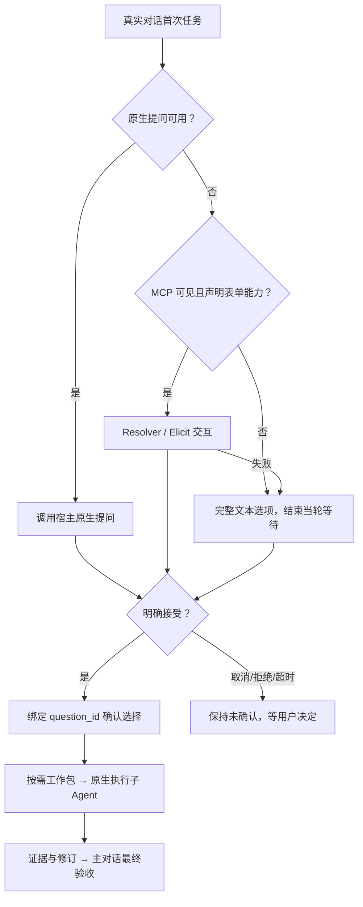

# single-conversation-subagent 2.2.0

单对话两级 Subagent 协作，采用 **Skill 策略 + 可选本地 MCP 状态/交互 + 宿主原生 Subagent 执行**。主对话直接协调并最终验收，执行子 Agent 不继续委派；MCP 不创建 Agent，也不是独立 Agent 桥接器。

重点修复首次四选一有时不出现时的处理：优先真实调用宿主原生提问，其次使用声明支持的 MCP 表单，最后显示完整文本选项并结束当轮等待明确回复。**安装 MCP 不保证弹窗出现。** 推荐项、未回复、取消、RPC 失联和 UI 不出现均不算确认。



本对话模式：快速处理 / 标准执行 / 长任务 / 只调查，只给一个按风险、范围、成本动态决定的推荐。后续沿用本对话结果；新对话重新开始。标准/长任务首次确认验证范围；只有明确注册 codex-review 才追加收尾使用/不使用，唯一推荐不使用。已有明确用户授权可直接记录沿用。快速与只调查不强制初始化工作包。

“不做测试”和“只记录方法”各自与其他验证操作互斥，均 NOT_RUN；危险操作独立确认。仅用户明确“不用问，直接做”可跳过模式选择，不能因此授权删除、擦除或烧录。超时只认可宿主可观测结果和事先告知的策略；本版服务只记录超时，不自动确认。

## 安装

纯 Skill 不依赖 Python，也不需要 MCP：

```bash
bash install.sh --mode skill --with-default-rule
bash install.sh --check
```

默认目录 `$AGENT_HOME/skills/single-conversation-subagent/`，AGENT_HOME 默认 `~/.agents`。原有无参数、`--with-default-rule`、`--instructions-file PATH`、`--uninstall` 均保留。可指定宿主实际读取的用户指令文件：

```bash
AGENT_HOME=/path/to/agent-home bash install.sh --instructions-file /path/to/AGENTS.md
```

混合安装需要 Python 3.11+，本地 POSIX 文件系统和 bash/tar。此版本安全路径实现已在 Linux 验证；Windows 原生 MCP 运行 **未支持/未移植**，可手动复制 Skill 使用纯文本回退。macOS 待实测。

```bash
bash install.sh --mode hybrid --with-default-rule --project-root /absolute/project
bash install.sh --mode hybrid --check
```

如选定 Python 已有 mcp 2.3.0 则使用该解释器；否则在 `$AGENT_HOME/mcp/single-conversation-subagent/venv.<id>` 创建隔离环境并安装依赖。可用 `--python /absolute/venv/bin/python` 或 SCS_PYTHON 指定现有环境。Python 或依赖失败时输出 HYBRID_UNAVAILABLE，Skill 保持可用；`--mode hybrid --check` 会明确报告未就绪。

安装器在修改前备份，只替换本技能的标记块，保留其他技能/项目内容；重复安装不重复注入规则。拒绝目标及其父目录的符号链接、父目录跳转、畸形规则标记和源目录自覆盖。安装器不改写现有客户端 MCP 配置；生成可审查示例到 runtime 的 `client-examples.json`、`codex-example.toml`，由用户复制合并。未给 project-root 时须替换示例占位符。**重开对话**以加载 Skill 和规则变更。

手动安装：复制 `single-conversation-subagent/` 到宿主实际的 skills 目录，再把 AGENTS.snippet.md 的标记块合入宿主读取的指令文件；无 bash/无 Python 也能使用纯 Skill。不要覆盖其他标记块或已有项目记忆。

## 客户端配置

开发安装与直接入口：

```bash
python3 -m venv .venv
.venv/bin/python -m pip install -e './mcp_server[test]'
.venv/bin/python -m scs_mcp --project-root /absolute/project
```

该入口只使用 stdio，不启动 HTTP。stdout 只传 MCP 协议，错误写 stderr；脱敏交互事件保存在项目 `.scs/state.sqlite3` 的 events 表。依赖固定 `mcp==2.3.0`，开发环境完整版本见 [requirements-dev.lock](mcp_server/requirements-dev.lock)；项目级约束见 pyproject.toml。重现测试环境可先安装锁文件再安装本包。

Codex TOML 示例（复制前按实际路径修改，不需要放宽审批或信任）：

```toml
[mcp_servers.single-conversation-subagent]
command = "/absolute/repository/.venv/bin/python"
args = ["-m", "scs_mcp", "--project-root", "/absolute/project"]
```

JSON stdio 示例（适用于使用 mcpServers 格式的客户端；逐客户端核对导入位置）：

```json
{
  "mcpServers": {
    "single-conversation-subagent": {
      "command": "/absolute/repository/.venv/bin/python",
      "args": ["-m", "scs_mcp", "--project-root", "/absolute/project"]
    }
  }
}
```

ZCode 用户配置位于 `~/.zcode/cli/config.json`，字段是嵌套的 `mcp.servers`（不是顶层 `mcpServers`；schema 严格，未知键会丢弃该服务）：

```json
{
  "mcp": {
    "servers": {
      "single-conversation-subagent": {
        "type": "stdio",
        "command": "/absolute/repository/.venv/bin/python",
        "args": ["-m", "scs_mcp", "--project-root", "/absolute/project"],
        "env": {"SCS_HOST": "zcode", "SCS_QUESTION_CHANNEL": "mcp"},
        "timeoutMs": 60000
      }
    }
  }
}
```

ZCode 的 stdio 客户端会先用 2026-07-28 信封探测 `server/discover`，随后按 legacy 形状继续；服务端已内置兼容层：对 ZCode（或未声明身份）的探测本地返回 `-32022` 并剥离后续 2026 `_meta` 信封，回落到 2025-11-25 握手。明确声明为其他客户端的 modern 探测保持原路径。`--host zcode` 默认 `SCS_QUESTION_CHANNEL=mcp`，四选一/验证/审查用 `interaction_ask(timeout_seconds=15)`（仅 legacy form）；无 form 或 modern 无回通道时问题保持 `WAITING_USER`，用同一 `question_id` 直接 `interaction_submit`。ZCode 原生 AskUserQuestion 自动解析是 60 秒隐藏 + 5 分钟截止，不是 15 秒。stdio 序列已验证；宿主 UI/elicitation 显示仍需在 ZCode 会话内视觉确认。

混合安装器生成的示例使用稳定的 runtime/launcher.py 入口，无需依赖仓库位置。Codex 配置格式参考 [官方 MCP 文档](https://learn.chatgpt.com/docs/extend/mcp?surface=cli) 并与本机 CLI help 核对；Claude Code JSON/stdio 参考 [官方 MCP 文档](https://code.claude.com/docs/en/mcp)。

### 宿主与提问通道

一份工程、同一套 Skill/MCP，可被多个宿主使用；提问通道在安装期选择，不做两套主对话/子 Agent 流程：

```bash
bash install.sh --mode hybrid --host codex --project-root /absolute/project
bash install.sh --mode hybrid --host zcode --project-root /absolute/project
bash install.sh --mode hybrid --host claude --question-channel auto --project-root /absolute/project
```

- `--host`：`codex|zcode|claude|generic`，写入示例的 `SCS_HOST`。
- `--question-channel`：`auto|native|mcp|text`，写入 `SCS_QUESTION_CHANNEL`；未指定时 `codex→native`、`zcode→mcp`、其他→`auto`。
- 服务器启动时读取 env；`session_open` 返回 `question_channel` 与 `host`。Skill 按它路由：`native`→原生，`text`→文本，`mcp`→`interaction_ask`（15s），`auto`→form 可用则 mcp，否则 native/text。
- `interaction_ask` 只在 legacy stdio 的 back-channel 上开 form；modern/无 form 回落会保留 `question_id`，用户明确回复后直接 `interaction_submit`。原生/文本路径不声称 15s。
- 安装器生成 `client-examples.json`、`codex-example.toml`、`host-profile.json`；不改写现有客户端配置，复制时按宿主保留 `env`。

## 能力矩阵与验收层次

记录日期 2026-11-11（ZCode 行更新）。“待验证”包括没有实际执行的能力；官方文档支持不等于本项目集成通过。

| 客户端 | Skill 注入 | stdio 连接本服务 | 原生提问 | 本服务 MCP elicitation / 真实 UI |
| --- | --- | --- | --- | --- |
| 官方 Python SDK 2.3.0 参考客户端 | 不适用 | 已验证：实际子进程与原始协议 | 不支持原生 UI | 已验证新旧协议回调；无 UI，渲染不适用 |
| 官方 Python SDK 1.30.0 旧客户端 | 不适用 | 已验证：独立环境连接最终安装包 | 不支持原生 UI | 已验证三问、多选及无能力回退；无图形 UI |
| 当前 Codex 桌面聊天；CLI 0.167.0-alpha.3.2（本机二进制） | 已加载现有 Skill；新版待重开验证 | NOT_RUN：本机未注册 SCS MCP；原生/文本回落可用 | 当前会话有 `request_user_input_async`；不假设所有 Codex 都有 Ask/Question | NOT_TESTED；form/back-channel 未在本版本握手验证 |
| Claude Code 2.1.1（本机版本） | 待验证 | 待验证；官方有 stdio 文档 | 待验证 | NOT_TESTED |
| ZCode 3.15（用户级 `mcp.servers`，`--host zcode`） | 已加载现有 Skill；新会话待重开 | 已验证：stdio 兼容层（ZCode 2026-07-28 探测回落 2025-11-25），17 工具；`question_channel=mcp`，15s 走 `interaction_ask`（legacy form） | 待宿主确认 | NOT_TESTED |

当前宿主的原生提问链路已收集真实用户选择；本服务器的完整会话→提问→提交→工作包→证据→handoff 链路由 SDK 参考客户端实际运行。ZCode 已完成用户级 stdio 注册与原始握手验证；Codex 未注册 SCS MCP，原生/文本回落可用，form/back-channel 未验证。尚未在 Codex/Claude/ZCode 的新会话内视觉观察本服务的 elicitation UI，不能宣称桌面客户端 UI 已通过或 100% 弹窗。

## Obsidian 项目管理

仍是 **1 个 MCP 服务，现在提供 17 个工具**。新增两个视图工具，不需要再安装另一套 MCP 或 Obsidian 社区插件。

每个项目选中的 docs-root 就是独立的 Obsidian 库根。默认 `00_doc → 00_docs → docs → doc`，都没有时使用 docs；视图在 `<docs-root>/agent/acceptance/`，与项目资料、记忆和证据保持同一文档根。

```json
{"session_id":"S-...","initialize_vault":true,"auto_refresh":true}
```

调用 `project_view_refresh`：生成项目总览、状态分组、已完成子任务、工作包/历史修订页及来源链接。`initialize_vault=true` 只创建缺失库的 `.obsidian/app.json`（空配置），已有配置不改、不装插件。默认开启视图后的工作包自动刷新；以后 MCP 创建/更新工作包时更新页面。若视图冲突，原工作包仍保存成功，`view_update` 单独报告错误，不能因此重复提交工作包。

调用 `project_view_info(session_id)`：只读检查过期/手改漂移/证据问题，返回 `vault_root` 和编码后的 `open_uri`；不创建文档目录、不启动软件。首次在 Obsidian 选择 **Open folder as vault（打开文件夹为仓库）**，选中 vault_root。注册后可点击 open_uri 直接打开项目总览；链接用文件绝对路径，避免多个项目都叫 docs 时混淆。此流程依据 [Obsidian 管理库](https://help.obsidian.md/Files+and+folders/Manage+vaults) 与 [URI 官方文档](https://help.obsidian.md/Extending+Obsidian/Obsidian+URI)。

每页 `manual:begin / manual:end` 标记之间可写手工批注，刷新原样保留。生成区域被修改、标记异常或目标文件不属于本生成器时拒绝覆盖。单文件原子替换和内容前置检查防止常见并发覆盖；服务进程之间串行，外部编辑器不受硬锁约束。中断后可重试刷新自身的部分生成结果。既有源记忆不被投影视图覆盖，旧目录记录只链接/标明库外位置，不迁移。

“已完成子任务”表示已报告通过且本次核对证据未变；工作包仍需主对话最终验收。旧版只保留当前工作包的数据库升级时，仅回填实际当前修订；不虚构早期历史。迁移升级到 schema 2，原会话、工作包、证据保持不变；旧版 2.0 程序不能读取 schema 2，升级前应备份状态，回滚时恢复对应备份。

完整用法、冲突恢复和数据边界见 [Obsidian 视图说明](single-conversation-subagent/references/obsidian.md)。当前实现不自动修改全局库注册列表，创建 .obsidian 不代表已注册或已打开；Obsidian GUI/URI 真正唤起仍需在本机手工验证。

## 工具与状态

| 工具 | 用途 |
| --- | --- |
| session_open / session_get | 绑定宿主真实对话、返回 `question_channel`/`host`、已确认选择与未决问题；`project_root` 可省略 |
| interaction_request / interaction_submit / interaction_reopen | 原生记账、兼容 MCP 提问、文本回退、幂等提交与显式重试；按 host channel 路由 |
| interaction_ask | `mcp` channel 的 legacy form 服务端 `timeout_seconds`（默认 15s）；超时返回 `TIMED_OUT` + 推荐项；modern/无 form 保持 `WAITING_USER`，同一 `question_id` 直接 submit |
| diagnostics_check | 依赖、数据库、工具注册、声明能力、脱敏事件；不推断 UI |
| work_package_create / get / update | 可选工作包，修订、乐观版本、范围和子任务证据报告 |
| evidence_verify | 文件、路径、非空、内容与测试结果结构验证；不替代验收 |
| resource_acquire / release | 带 TTL/owner/token 的建议性文件/设备租约 |
| handoff_export / resume | 带摘要哈希的本地审计交接，不复制会话确认 |
| project_view_refresh / info | Obsidian 项目视图、批注保护、自动刷新、只读检查与打开链接 |

只读资源 `scs://session/{id}`、`scs://work-package/{id}`。完整参数、错误码、使用与恢复示例见 [MCP 用法](single-conversation-subagent/references/mcp.md)。

会话不以 cwd、PID、MCP 连接 ID 识别；不同宿主命名空间隔离，无可靠 ID 则显式临时会话。SQLite schema 2、WAL、事务、busy timeout；多进程使用相同项目 DB，工作包更新必须携带 expected_version。数据库路径及伴随文件不得为符号链接；证据读取通过目录描述符逐级拒绝符号链接和越界。状态目录不是进程级沙箱，不能防止同一用户的恶意外部进程替换整个目录；本服务不适合不互信多用户。

Markdown 由主对话同步：docs-root 依次为 00_doc、00_docs、docs、doc，均无则创建 docs。保持 `<docs-root>/agent/AGENT_PROJECT.md`、`AGENT_COORDINATION.md`、`evidence/WP-<id>/R<rev>/<subtask-id>/` 及 `04_test/report/`。服务只初始化缺失记忆文件，绝不覆盖既有内容；所有工作包变更提示 record_sync_required。MCP 断开时纯 Skill 维护文件；恢复前显式核对，当前不提供自动导入器或自动覆盖。

## 测试与故障排查

```bash
.venv/bin/python -m pytest -q mcp_server/tests
python3 /path/to/skill-creator/scripts/quick_validate.py single-conversation-subagent
bash -n install.sh
```

测试覆盖与实际结果见 [验收报告](docs/validation.md)。测试使用临时项目/安装目录，不修改用户配置，不启动任何付费模型会话。SDK 回调输入是模拟选择，与真实用户 UI 结果分开记录。

Inspector 可按 [SDK 官方文档](https://py.sdk.modelcontextprotocol.io/) 连接 stdio 入口；已安装 Node 时可运行：

```bash
npx @modelcontextprotocol/inspector /absolute/repository/.venv/bin/python -m scs_mcp --project-root /absolute/project
```

Inspector 属于手工诊断工具，本次未安装/运行；不能用 Inspector 连接成功代替宿主 UI 验证。

旧版 SDK 的实际兼容探针为 `scripts/probe_legacy_sdk1.py`，用隔离的 `mcp==1.30.0` 解释器运行；`--server-python` 指向安装 SDK 2.3.0 与 scs_mcp 的解释器，必要时用 `--server-pythonpath` 指定源码/安装目录。示例：`legacy-venv/bin/python scripts/probe_legacy_sdk1.py --server-python /absolute/server-venv/bin/python`。它只使用临时项目和模拟回复，不启动模型，也不证明 UI 渲染。

| 现象/分类 | 可用证据与处理 |
| --- | --- |
| SKILL_NOT_LOADED | 安装检查只能证明文件；核对宿主技能列表/注入记录，重开聊天 |
| TOOL_NOT_CALLED | 核对宿主调用日志；服务无法观察没有发生的调用 |
| ELICITATION_UNSUPPORTED | 检查初始化声明/diagnostics；展示 TEXT_FALLBACK_REQUIRED 并等明确回复 |
| RPC_ERROR | 与用户超时分开记录；读取未决题，文本回退或显式 reopen |
| UI_NOT_OBSERVABLE | 请求发出不证明已显示；需要宿主日志或用户视觉确认 |
| USER_CANCELLED / USER_DECLINED | 保持未确认，不按默认继续，用户要求后再重开 |
| DB_BUSY / VERSION_CONFLICT | 读取最新状态再核对并重试，不能覆盖其他写入 |
| 旧 requestState 重启后失效 | SDK 密封状态默认仅进程有效，核对未决题并显式重开 |

模型可能不遵循 Skill、客户端可能不显示表单或自动生成回执、真实 conversation ID 可能不可用；这些属于宿主边界。租约只约束遵守工具的参与者，不阻止外部修改。VERIFIED 仅证据文件/内容检查，测试执行真实性和最终 PASS/ACCEPT 必须由主对话核对原始证据。

## 迁移、回滚与文件布局

2.0 不兼容旧版等待后自动选推荐项的行为；取消与拒绝也不再隐式授权。迁移前备份指令文件，合并新的标记块，清理其他位置仍注入的旧规则，重开聊天；不迁移/删除项目记忆。完整执行协议见 [protocol.md](single-conversation-subagent/references/protocol.md)，版本记录见 [CHANGELOG.md](CHANGELOG.md)。原 docs/archify 图片保留为 1.x 历史参考，不表示 2.0 交互能力；HTML 文案已去除旧超时规则。

```text
single-conversation-subagent/   Skill、执行协议、MCP 使用参考
mcp_server/src/scs_mcp/        SDK 服务、交互、状态、SQLite、路径、证据、租约、交接
mcp_server/tests/              自动协议/状态/并发/安装回归
AGENTS.snippet.md / install.sh  轻量入口、兼容安装/检查/卸载
VERSION / CHANGELOG.md         发布版本和迁移说明
docs/                         设计与验收报告（运行记忆不打包）
```

卸载：`bash install.sh --uninstall`；若指定过 instructions-file，卸载时传同一路径。卸载会备份本技能/运行时并移除对应标记块，保留其他规则、客户端配置和项目 `.scs`/证据。手动从客户端删去本服务配置条目。回滚时恢复相应 `.bak.<时间>.<pid>` 的 Skill/规则/运行时，撤销本服务配置后重开聊天；不要用旧数据库版本覆盖较新状态。删除项目状态前自行备份，卸载器不会删除它。

## 可选桌面项目管理器

`desktop_tool/` 提供独立 PyQt5 管理器：项目添加/发现、目录浏览、Obsidian 跳转、工作包与 MCP 记录、短期连接自检、视图刷新和可恢复归档。参照本机 PyQt 工具风格；不进入 MCP 的安装器和依赖，不强制安装，也不管理宿主进程。运行 `bash desktop_tool/run.sh`，详情见 [管理器说明](desktop_tool/README.md)。

2.2 的管理器项目栏支持项目展开/收起并记住状态，按最后 MCP 活动或显式打开时间自动排序（可见时每 8 秒更新）。点击工作包子项直达记录。Obsidian 按钮使用项目 `.scs-obsidian/<库ID>/` 独立启动配置，首次无需手工登记；MCP `initialize_vault=true` 也会准备这套配置，不写全局库列表。
