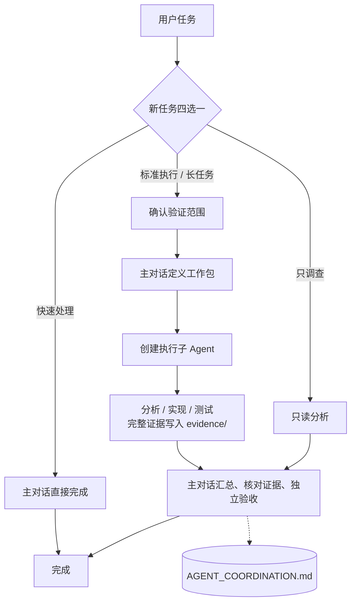

# 单对话 subagent：两级协作协议

（主对话（协调层） → 执行子 Agent）

记录日期：2026-10-19（Asia/Shanghai）；更新：2026-10-25（四选一不得按任务大小自动跳过）

## 结构

主对话是第一级协调者，直接负责目标、决策、阶段记忆、拆分、调度、汇总和验收；执行子 Agent 是第二级，只做分析/实现/测试，不再委派。不创建“协调子 Agent”。

设计初衷：隔离长执行线，让主对话只保留目标、决策、未决问题、下一步和证据路径；执行细节留在子 Agent 和证据文件。它不是缓存清理机制，主对话仍会随轮次增长。

流程：用户 → 主对话（协调/记忆/调度/汇总/验收）→ 执行子 Agent（分析/实现/测试）→ 主对话。



## 开场四选一

每个新的用户任务开始时先问一次，包括“推送吧/改一下/跑一下”这类直接命令；同一任务追问不重复问，只有用户明确说“不用问，直接做”才可跳过。不得因为任务看起来是纯问答、小改、单文件、简单查询或时间紧而自动跳过；任务大小只影响推荐项，不决定是否提问。

1. **快速处理**：主对话直接做，不启子 Agent（纯问答、搜索、小改、简单 Excel、快速查询）。
2. **标准执行**：先问验证范围，再给工作包/计划，然后实现和验证。
3. **长任务**：分阶段，计划前问验证范围，使用执行子 Agent。
4. **只调查**：只读分析，不改文件；范围大时用分析子 Agent。

只标一个推荐项并默认勾选，拿不准默认“标准执行”；推荐项不改变任务目标，也不代表可以跳过提问。用户未明确选择或超时，按“标准执行”继续，不按推荐项，不重复追问；真正的 15 秒倒计时由客户端实现。快速处理/只调查不做验证范围多选、不建执行子 Agent。只有用户明确说“不用问，直接做”才跳过四选一，并按快速处理开始；若实际需要标准执行/长任务，仍问验证范围。

推荐：纯问答/小改/简单 Excel → 快速处理；多文件实现/构建测试 → 标准执行；全量回归/烧录/稳定性 → 长任务；只读定位/方案对比 → 只调查；拿不准 → 标准执行。

## 验证范围（标准执行 / 长任务）

每个新任务问一次，只给一个推荐路径：**快速冒烟（本轮）+ 定向回归（收尾）**。其他选项不标推荐/默认。

| 选项 | 时机 | 耗时 | 资源 | 说明 |
| --- | --- | --- | --- | --- |
| 快速冒烟 | 本轮 | 2 min | 无 | 推荐组合 |
| 定向回归 | 收尾 | 15 min | 板卡 A | 推荐组合 |
| 全量回归 | 收尾 | 2 h | 板卡 A | 备选 |
| 长时间稳定性 | 收尾 | 8 h | 独占板卡/串口 | 备选 |
| 烧录/擦除 | 按需 | 10 min | 烧录器 | 单独确认 |
| 不做测试 | 本轮/收尾 | 0 | 无 | 与测试互斥 |
| 不做测试但记录方法 | 本轮/收尾 | 0 | 无 | 与测试互斥 |

- 定向/全量回归和稳定性收尾执行，不每轮重复。
- “不做测试”标记 `NOT_RUN`；“记录方法”只写命令/环境/预期结果到 `AGENT_COORDINATION.md`，不标 `PASS`。
- 每次只给一个推荐路径；未选中的长耗时操作不执行，新增操作走新修订；烧录/擦除单独确认。
- 未明确选择或超时，按唯一推荐路径（快速冒烟 + 收尾定向回归）继续，不重复追问；真正的 15 秒倒计时由客户端实现。

## 工作流程

1. 四选一（每个新任务必问，不得按任务大小自动跳过）；标准/长任务再问验证范围。
2. 主对话定义工作包：目标、验收、目录、基线、允许/禁止操作、子 Agent 类型、证据要求。
3. 主对话读写默认记忆：`docs/agent/AGENT_PROJECT.md`、`docs/agent/AGENT_COORDINATION.md`、`docs/agent/evidence/`。
4. 拆分子任务；独立只读可并行，同文件/板卡/串口/烧录串行。
5. 用 `Agent` 工具创建执行子 Agent，名称按任务；提示含子任务、范围、禁止、检查、证据路径、“不得再委派”。
6. 子 Agent 执行并落证据；只回传状态、动作、证据路径、首异常、剩余问题、资源释放，不贴原始日志。
7. 主对话汇总：核对证据，区分 `PASS/FAIL/BLOCKED/NOT_RUN/SUBSTITUTED`，更新协作记录。
8. 主对话独立验收 diff/日志/测试/产物；只有主对话更新验收结论。
9. 同一工作包继续在主对话；压缩/重启时从 `AGENT_COORDINATION.md` 恢复。

## 记忆与上下文预算

默认路径：

| 文件/目录 | 维护者 | 内容 |
| --- | --- | --- |
| `docs/agent/AGENT_PROJECT.md` | 主对话 | 目标、决定、撤回方案、进度、验收 |
| `docs/agent/AGENT_COORDINATION.md` | 主对话 | 阶段记忆、子任务、依赖、证据索引、异常 |
| `docs/agent/evidence/WP-<id>/R<rev>/<subtask-id>/` | 子 Agent/主对话 | 完整日志、测试输出、截图、报告 |

- 三级记忆：主对话摘要 → 协作记录 → 证据文件；主对话只读关键证据。
- 子 Agent 回传有界（建议 ≤1–2 KB），不贴原始日志。
- 每个工作包/阶段结束写 handoff；主对话接近 60%–70% 上下文或压缩时，新开会话，从文件恢复。
- 长测试后台化：子 Agent 返回 PID/日志/状态/停止方式后结束，主对话按检查点查询。
- 子 Agent 上下文过大时停止并新建，传摘要和证据路径。
- 同一对话内保持系统提示/AGENTS/skill 稳定；规则变更新会话生效。
- 与桥接模式共存时，使用 `docs/agent/AGENT_PROJECT_NATIVE.md` / `AGENT_COORDINATION_NATIVE.md`，不要改桥接受管文件。

## 回传格式

子 Agent 最终消息至少包含：状态、实际动作、证据路径、首异常、剩余问题、资源释放。主对话阶段汇总可用：

```json
{
  "work_package": "WP-<id>",
  "revision": 1,
  "state": "REVIEW_READY",
  "memory": "事实、假设、排除项、关键决定",
  "children": [{"id": "agentId 或 T1", "task": "...", "status": "PASS", "evidence": "docs/agent/evidence/..."}],
  "risks": ["..."],
  "next_steps": ["..."],
  "needs_user_decision": ["..."]
}
```

`state`：`REVIEW_READY` / `PARTIAL` / `BLOCKED`。子任务状态：`PASS` / `FAIL` / `BLOCKED` / `NOT_RUN` / `SUBSTITUTED`；没有证据不能标 `PASS`。

## 边界

1. 只有主对话创建子 Agent；子 Agent 不继续委派。
2. 子任务范围 ≤ 父工作包；不授予文件/网络/提交/推送/烧录权限。
3. 调查只读；测试不改源码/不重建/不换镜像；实现只改允许文件。
4. 同文件/同设备串行；不重复提交；停止确认终态后释放资源。
5. 编译成功、任务结束、现场恢复、根因修复分别报告；最终由主对话验收。
6. 子 Agent 不改顶层规划/记忆文件/验收/安全策略；冲突回主对话。
7. 不伪造 ID/状态/证据；取不到 `agentId` 记“ID 不可得”。
8. 无法创建真实子 Agent → `BLOCKED`，不静默降级；只有用户授权才单级回退。
9. 回传有界；长测试后台化；接近上下文上限写 handoff 并新会话。
10. 不记录密钥/Cookie/私有 URL/原始推理；用户明确指令优先。
11. 四选一超时或未明确选择时按“标准执行”处理，不按推荐项，不重复追问；真正的倒计时由客户端实现。
12. 验证范围超时或未明确选择时按唯一推荐路径（快速冒烟 + 收尾定向回归）处理，不重复追问；真正倒计时由客户端实现。
13. 每个新任务都必须发起四选一；不得按任务大小/类型自动跳过。唯一例外是用户明确说“不用问，直接做”。

## 与桥接模式的区别

| 维度 | 三层桥接 | 单对话两级 |
| --- | --- | --- |
| 协调者 | 外部桥接会话 | 主对话自己 |
| 记忆 | 桥接自动写 | 主对话显式写 |
| 核验 | 父子目录自动核验 | 主对话核对 diff/日志/测试/产物 |
| 适用 | 跨工具、程序化核验 | 单对话快速拆分 |

## 原生接入

```text
Agent(
  description="<任务>子 Agent",
  subagent_type="general-purpose",
  run_in_background=false,
  prompt="""
你是工作包 WP-<id> / R<n> 的执行子 Agent，角色：<分析/实现/测试>。
主对话负责目标、阶段记忆、调度和验收；你不创建下一级 Agent。
工作目录：<cwd>
子任务：<...>
输入上下文：<...>
允许范围：<文件/设备/操作>
禁止事项：<...>
基线：<...>
检查方法：<...>
证据写入：<项目根>/docs/agent/evidence/WP-<id>/R<n>/<subtask-id>/
最终消息：实际动作、逐项结果、证据路径、首异常、剩余问题、资源释放。
"""
)
```

## 检查清单

- [ ] 每个新任务都发起了四选一，没有按任务大小自动跳过；只给一个推荐项。
- [ ] 标准/长任务已问验证范围；只给一个推荐路径。
- [ ] 未选中的长耗时操作没有进入计划；破坏性操作单独确认。
- [ ] 执行子 Agent 是真实 Agent 调用，没有下一级委派。
- [ ] 证据已落盘，主对话检查了关键证据和实际产物。
- [ ] 阶段结束写了 handoff；上下文接近上限时新会话恢复。
